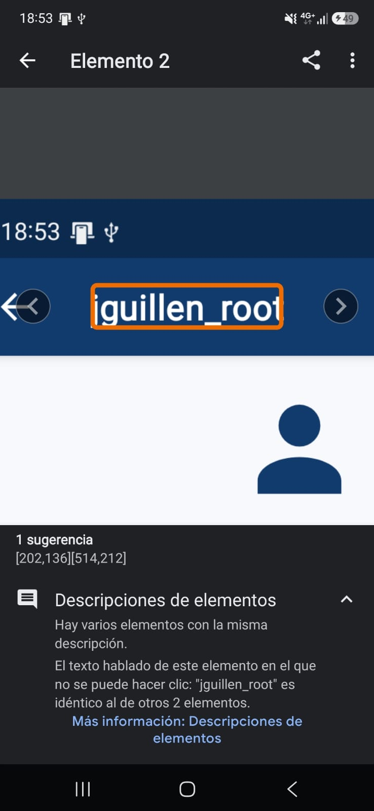
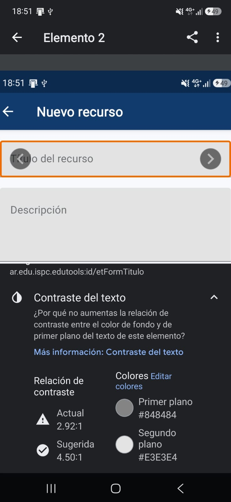
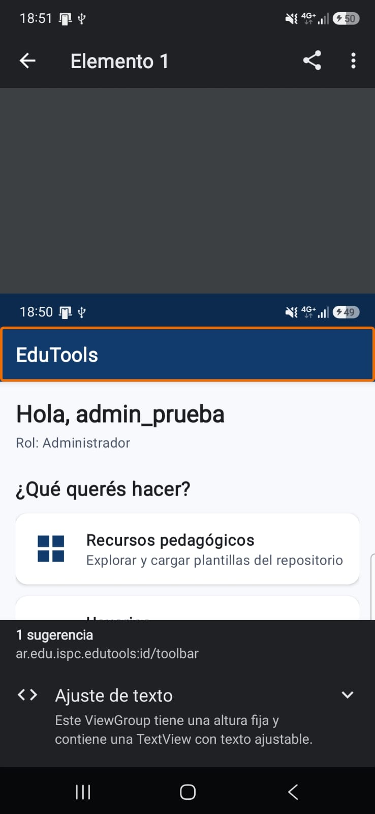

# Informe de accesibilidad (Accessibility Scanner)

Se pasó **Accessibility Scanner** (Google) en un Samsung SM-A546E con la app conectada al backend de pruebas. Encontró 3 sugerencias, registradas en el [Issue #39](../../../../issues/39) y corregidas en el PR #37.

| # | Pantalla | Hallazgo del escáner | Causa | Corrección |
|---|----------|----------------------|-------|------------|
| 1 | Perfil de usuario | Descripciones de elementos: el texto hablado `jguillen_root` es idéntico al de otros 2 elementos | El mismo texto estaba en el título de la toolbar y en los campos de nombre y de usuario | Título fijo "Perfil de usuario"; si el usuario no tiene nombre se muestra "Sin nombre cargado" |
| 2 | Nuevo recurso (`etFormTitulo`) | Contraste del texto: 2.92:1 (#848484 sobre #E3E3E4), sugerido 4.50:1 | Color de hint por defecto de Material | Los hints de todos los `TextInputLayout` usan `edu_texto_secundario` (estilo `Widget.EduTools.CampoTexto`) |
| 3 | Inicio (`toolbar`) | Ajuste de texto: la vista tiene altura fija y contiene un texto ajustable | `layout_height="?attr/actionBarSize"` fijo | `layout_height="wrap_content"` con `minHeight="?attr/actionBarSize"` |

## Capturas del escáner

## Pendiente

Volver a pasar el escáner con la versión corregida y sumar las capturas "después" para confirmar que ya no marca estos tres puntos.
