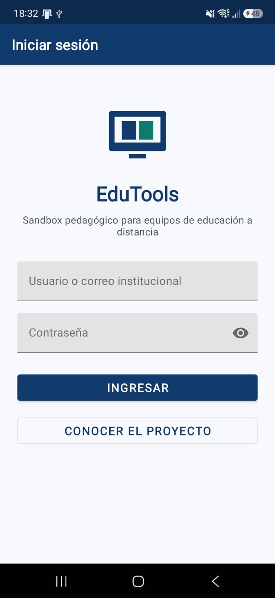
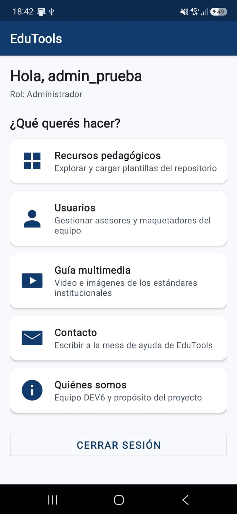
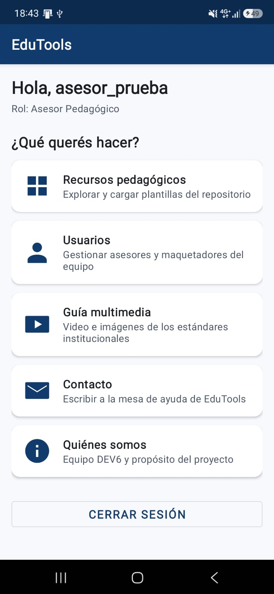
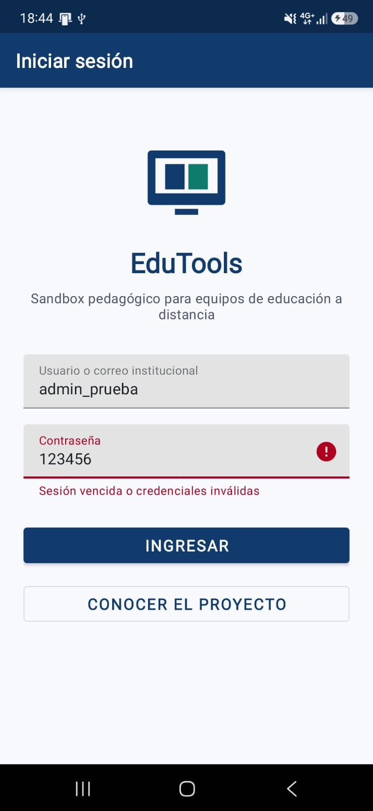

# Pruebas manuales en dispositivo (Issue #25)

Se probó la app en un **Samsung SM-A546E** (instalada desde Android Studio) contra el backend publicado en `https://dev6.pythonanywhere.com/`, usando datos móviles (fuera de la red del equipo). Para la prueba se crearon dos usuarios de prueba en el servidor: `admin_prueba` (rol admin) y `asesor_prueba` (rol asesor).

| # | Caso | Pasos | Resultado esperado | Resultado |
|---|------|-------|--------------------|-----------|
| 1 | Pantalla de login | Abrir la app | Se ve el formulario de login | OK |
| 2 | Login como admin | Ingresar con `admin_prueba` | Pasa al Home con "Rol: Administrador"; en Usuarios se ve el botón "+" | OK |
| 3 | Login como asesor | Cerrar sesión e ingresar con `asesor_prueba` | Pasa al Home con "Rol: Asesor Pedagógico"; en Usuarios no hay "+" y la lista muestra el 403 ("No tenés permiso para esta acción") | OK |
| 4 | Credenciales inválidas | Ingresar con una contraseña incorrecta | Mensaje "Sesión vencida o credenciales inválidas" (401), sin guardar sesión | OK |
| 5 | Datos móviles | Repetir el login con el wifi apagado | El login funciona contra el servidor público | OK |
| 6 | Cierre de sesión | Tocar "Cerrar sesión" | Vuelve al login y se borran los tokens | OK |
| 7 | Contraseña débil en Registro | Entrar como admin, Usuarios, botón "+" y en Registro escribir `abcdefghi` | El campo muestra "Agregá al menos un número." y no se envía | Pendiente de ejecutar en el celular |
| 8 | La sesión sobrevive al cierre | Iniciar sesión, cerrar la app desde recientes y abrirla de nuevo | Entra directo al Home con el mismo rol (token en `EncryptedSharedPreferences`) | OK |
| 9 | Cerrar sesión borra la sesión guardada | Tocar "Cerrar sesión", cerrar la app y abrirla | Aparece el login | OK |

## Capturas

| Caso | Captura |
|------|---------|
| Login |  |
| Admin en el Home |  |
| Asesor en el Home |  |
| Contraseña incorrecta (401) |  |

## Notas

- La seguridad real la aplica el servidor: la app solo usa el rol del token para mostrar u ocultar botones. Un asesor que llame a `POST api/users/{id}/set-role/` recibe 403 (cubierto por `users/tests_seguridad.py` en el backend).
- Los tests automáticos de esta parte están en [PRUEBAS_UNITARIAS.md](PRUEBAS_UNITARIAS.md).
